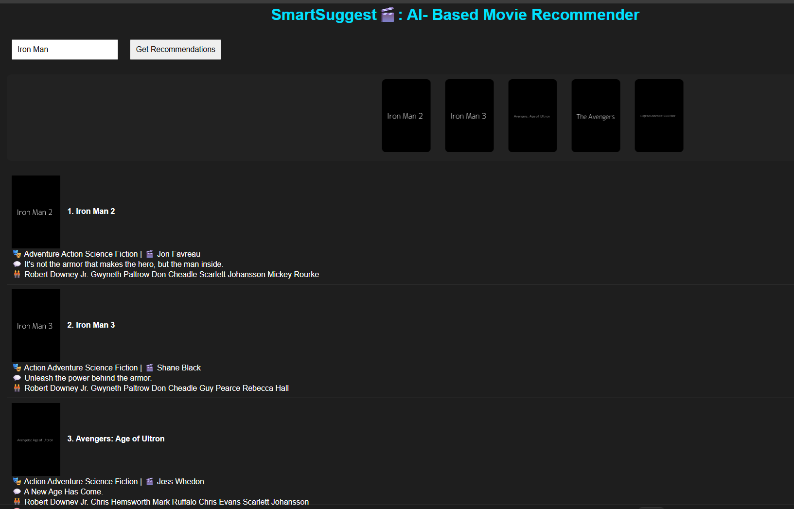
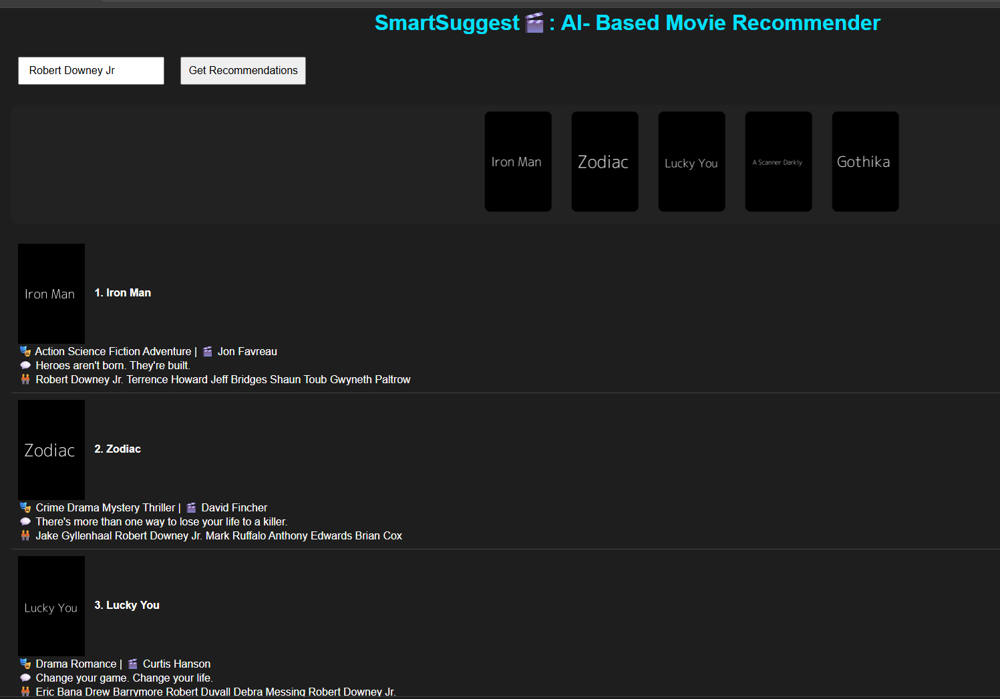
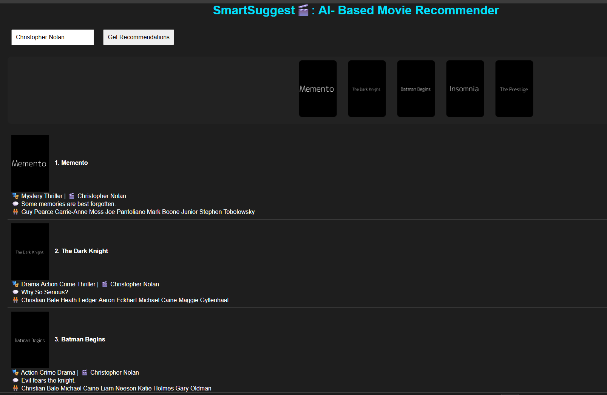

# 🎬 SmartSuggest: AI-Based Movie Recommender

SmartSuggest is a full-stack movie recommendation app. Enter a **movie title, an actor, or a director** and get the top 10 most relevant movies instantly.

The backend is built with **FastAPI** and a content-based recommendation engine (TF-IDF + cosine similarity). The frontend is a simple dark-themed page built with HTML, CSS and JavaScript.

## 📸 Screenshots

| Search by movie | Search by actor | Search by director |
|---|---|---|
|  |  |  |

## ✨ Features

- Search by **movie title**, **actor**, or **director**
- Returns the **top 10** recommendations
- **Fuzzy matching** handles spelling mistakes in movie titles
- Scrolling poster strip plus a detailed results list (genre, director, tagline, cast)
- REST API with automatic interactive docs (Swagger UI)
- CORS enabled, so any frontend can use the API

## 🧠 How It Works

1. **Data:** a public movie dataset is loaded with Pandas.
2. **Feature engineering:** genre, keywords, tagline, cast and director are combined into a single text profile for each movie.
3. **Vectorization:** `TfidfVectorizer` converts each profile into a numerical vector.
4. **Similarity:** `cosine_similarity` computes how close every movie is to every other movie.
5. **Matching:** the user's input is matched to a title using `difflib`. If no title matches, the app searches the cast and director columns.
6. **Serving:** FastAPI returns the top 10 results as JSON, and the frontend displays them.

## 🛠 Tech Stack

| Layer | Technology |
|---|---|
| Backend | Python, FastAPI, Uvicorn, Pydantic |
| ML / Data | Pandas, scikit-learn (TF-IDF, cosine similarity), difflib |
| Frontend | HTML, CSS, JavaScript (Fetch API) |
| Dataset | [YBI Foundation Movies Recommendation dataset](https://github.com/YBI-Foundation/Dataset) |

## ⚠️ Known Limitations

- Posters are **placeholder images**. Real posters are planned through the TMDB API.
- Actor and director search uses **exact substring matching**, so spelling mistakes in names are not corrected (titles are).
- Recommendations are based on the dataset's metadata only, with no user ratings or viewing history.

## 🔮 Future Improvements

- [ ] Real movie posters via the TMDB API
- [ ] Typo-tolerant actor and director search
- [ ] React frontend
- [ ] Filters by genre and release year
- [ ] Deployment (Render / Railway for the API, GitHub Pages or Vercel for the frontend)

## 📚 What I Learned

- How content-based filtering works with TF-IDF and cosine similarity
- How to expose an ML model as a REST API with FastAPI
- How to connect a backend and frontend using the Fetch API and CORS
- How an off-by-one indexing bug can silently produce wrong recommendations, and why validating model output matters

## 👤 Author

Nithish Dudde
- LinkedIn: (https://www.linkedin.com/in/nithish-dudde-4954311b9)

## 📄 License

This project is for learning purposes. The dataset belongs to its original authors.
